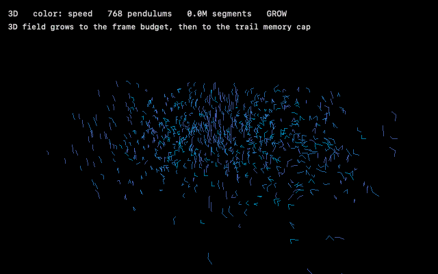
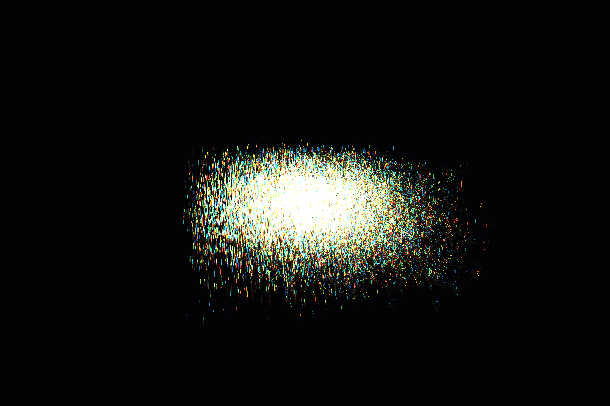

# Pendularium

> [!NOTE]
> **AI disclosure.** Built with generative AI assistance (Claude Code by Anthropic). The concept,
> direction, and review are my own; the AI drafted most of the code, tests, and this README, and
> I review everything before it ships. Commits carry a `Co-Authored-By` trailer for the model.

A native macOS generative-art engine that paints a zoomed-out, fractal-like image from a field
of **chaotic double pendulums** swinging in 3D. Every run is seeded differently, so no two images
are alike. Built in Swift + Metal, runnable straight from the terminal.

It is a fun visualizer first. It is also a small instrument and a data generator: each of the
three color modes is a measurement of the chaotic field, `--report` writes those measurements as
numbers — including a Lyapunov exponent estimated from twin pendulums seeded a ten-thousandth of a
radian apart — and `--export-csv` / `--stream` emit the whole run as tables, so the same numbers
can be reproduced in SQL. A seed plus a pendulum count is a complete, reproducible description of
a chaotic multivariate time series with known structure, which makes it a handy fixture for
pipelines, warehouses, and anomaly-detection experiments.

## Demo



[Watch the 25-second demo (MP4)](https://github.com/rwaterman/pendularium/releases/latest/download/pendularium-demo.mp4)
— it continues into 2D mode, where the head-on view reveals the coherent seeding field.

<!-- Inline player: drag pendularium-demo.mp4 into this file in GitHub's web editor and paste
     the user-attachments URL it inserts on its own line here. -->

Both are rendered from code: a scripted run "presses" the live controls on a schedule, every
frame is rendered offscreen, and the HUD is composited in. No screen recording, no ffmpeg.

```sh
swift run -c release Pendularium --seed 42 --gif demo.gif
swift run -c release Pendularium --seed 42 --record demo.mp4
```

## What it does

- Spawns thousands of planar **double pendulums** (the classic chaotic system), integrated on the
  CPU with **RK4** plus per-step **energy renormalization** so the motion stays lively indefinitely.
- **Coherent seeding**: neighboring pendulums start from a randomized *smooth field* of initial
  angles, so the field begins ordered and chaos shatters it over time — sensitive dependence on
  initial conditions, made visible. Every run uses a different field, so no two images are alike.
- Each bob's tip leaves a **persistent, accumulating trail** blended additively into an **HDR
  buffer**, then tone-mapped to the screen. The high dynamic range keeps the dense core from
  clipping to white, so structure and color survive everywhere.
- **Two views**: a **3D** volume with a slow auto-orbit, and a flat head-on **2D** plane
  (orthographic) where all trails overlap into one dense image. Toggle live with `D`.
- **Three color modes**, cycled live with `C` (recolors the whole painting instantly):
  - **speed** — cool→hot by instantaneous bob speed (the chaotic energy distribution),
  - **identity** — a per-pendulum hue that tracks each trajectory (divergence / mixing),
  - **phase** — hue by swing angle (who is in / out of sync).
- The population **grows to the machine's performance budget** (or stays at `--pendulums <n>`),
  then trails accumulate to a memory cap and it **pauses at the limit** — the final painting holds
  while you drag/zoom/recolor it. The graceful end of "until it can't draw any more."



## What it measures

The color modes are three views of the same chaotic field, and the run report turns each into a
number. `swift run -c release Pendularium --seed 42 --autoshot 12 out.png --report run.json`
produces [`docs/report-seed42.json`](docs/report-seed42.json), which looks like this (abridged):

```json
{
  "seed": 42,
  "mode": "3D",
  "pendulums": 34752,
  "segments": 6291456,
  "field": { "k1": [0.0004, 0.0646, 0.0279], "phi1": 4.12, "k2": [-0.0657, 0.016, 0.0534], "phi2": 1.52, "amp": 3.14, "noise": 0.06 },
  "speedHistogram": [878, 1154, 1315, 1520, 1730, 1809, 1951, 2082, 2161, 2190, 2172, 2079, 2030, 1828, 1761, 8092],
  "sync": 0.143,
  "lyapunovPerSecond": 1.02,
  "samples": [
    { "t": 0,   "pendulums": 192,   "sync": 0.287, "meanLogSeparation": -9.21 },
    { "t": 0.5, "pendulums": 3072,  "sync": 0.242, "meanLogSeparation": -8.56 },
    { "t": 6,   "pendulums": 34752, "sync": 0.142, "meanLogSeparation": -2.83 }
  ]
}
```

| Color mode | What it paints | Report field |
| ---------- | -------------- | ------------ |
| **speed** | the energy distribution across the field | `speedHistogram` — 16 bins of normalized bob speed |
| **phase** | who is swinging in sync | `sync` — the Kuramoto order parameter of the swing angles (1 = all in phase, 0 = uniform). Starts ordered (0.29 from the coherent seed), collapses within a second. |
| **identity** | how neighboring trajectories diverge and mix | `meanLogSeparation` and `lyapunovPerSecond` — the first 64 even/odd pendulum pairs are **probe twins**, identical except for a 10⁻⁴ rad nudge. Their separation grows exponentially; the slope of its log (after the first e-fold, before it bends at ~0.1 rad) is the largest Lyapunov exponent. Seed 42 gives ≈1.02/s: nearby trajectories separate e-fold every second. |

`field` is the smooth seeding field (wave vectors and phases for θ1, θ2 and the identity hue), so
a report plus `--seed` fully describes a run. Samples are taken every 0.5 s of simulated time
while the field is growing. The 128 probe pendulums are part of the painting, indistinguishable
among tens of thousands.

## The run as data

```sh
swift run -c release Pendularium --seed 42 --pendulums 2000 --autoshot 20 out.png --export-csv run
```

`--pendulums` fixes the population (all spawned at frame 0, same age, no growth), and
`--export-csv` writes a small star schema into `run/`:

| Table | Grain | Columns |
| ----- | ----- | ------- |
| `pendulums.csv` | one row per pendulum | `id, spawn_frame, pivot_x/y/z, l1, l2, m1, m2, theta1_0, theta2_0, hue, energy, twin_of` |
| `samples.csv` | one row per pendulum per sampled frame | `t, frame, id, theta1, theta2, omega1, omega2, speed, x, y, z` |

`--every <frames>` sets the sampling stride (default 6, i.e. 10 Hz); the run above is 2,000 × 201
rows in 38 MB. `--stream` emits the same rows as JSON lines on stdout instead — each pendulum is
announced (`"kind":"pendulum"`) before its first sample (`"kind":"sample"`), so a consumer never
sees a fact before its dimension. Logs go to stderr, so stdout is clean:

```sh
swift run -c release Pendularium --seed 42 --pendulums 500 --autoshot 60 out.png --stream \
  | aws firehose put-record-batch ...    # or kcat, or > run.jsonl
```

The report's metrics fall straight out of the tables. With DuckDB:

```sql
CREATE TABLE pendulums AS FROM 'run/pendulums.csv';
CREATE TABLE samples   AS FROM 'run/samples.csv';
COPY samples TO 'run/samples.parquet';

-- phase mode: Kuramoto order parameter over time (the report's `sync`)
SELECT t, sqrt(avg(cos(theta2))^2 + avg(sin(theta2))^2) AS sync
FROM samples GROUP BY t ORDER BY t;

-- identity mode: probe-twin divergence and the Lyapunov exponent (the report's `lyapunovPerSecond`)
WITH sep AS (
  SELECT a.t, avg(ln(sqrt((a.theta1 - b.theta1)^2 + (a.theta2 - b.theta2)^2))) AS mean_log_sep
  FROM samples a
  JOIN pendulums d ON d.id = a.id AND d.twin_of IS NOT NULL
  JOIN samples b ON b.id = d.twin_of AND b.frame = a.frame
  GROUP BY a.t)
SELECT regr_slope(mean_log_sep, t) AS lyapunov_per_second
FROM sep WHERE mean_log_sep BETWEEN (SELECT min(mean_log_sep) FROM sep) + 1 AND ln(0.1);

-- speed mode: the energy distribution at the last sample (the report's `speedHistogram`)
SELECT least(floor(speed * 16), 15)::INT AS bin, count(*)
FROM samples WHERE frame = (SELECT max(frame) FROM samples) GROUP BY bin ORDER BY bin;
```

On the seed-42 run the SQL gives λ ≈ 1.03/s against the report's 1.01/s (the report samples at
2 Hz, the export at 10 Hz). Things the tables make easy that the screen does not: correlate
divergence with initial distance in the seeding field, find which pendulums stay phase-locked
longest, or feed a known-chaotic series with a known exponent to whatever you are testing.

`--export-ply <path.ply>` additionally writes the trail segments as a binary PLY with the current
colors baked in, for Blender / MeshLab / CloudCompare (~240 MB at the default trail cap). In the
window, `R` writes a report and `P` a PLY to the working directory.

## Requirements

- macOS 14 or later
- Xcode 16 or later (Swift 6 toolchain), including the command line tools
- A Mac with Metal; Apple Silicon recommended (the simulation is CPU-bound)

## Build and run

```sh
swift run -c release Pendularium
```

`-c release` is strongly recommended — the optimized build reaches many more pendulums before
saturating. A debug build works, it just saturates early.

### Controls

| Input    | Action                                            |
| -------- | ------------------------------------------------- |
| drag     | orbit (3D) / pan (2D)                             |
| scroll   | zoom                                              |
| `D`      | toggle 2D / 3D (restarts the painting)            |
| `C`      | cycle color mode (speed → identity → phase)       |
| `Space`  | pause / resume growth                             |
| `S`      | save a PNG screenshot to the working dir          |
| `R`      | write the run report (JSON) to the working dir    |
| `P`      | export the trails as a colored PLY                |
| `Q`      | quit                                              |

### Flags

```text
--seed <uint64>          reproduce a run's initial conditions
--2d                     start in 2D mode
--color <speed|identity|phase>   start color mode
--mem-mb <int>           trail-memory cap in MB (default 192)
--pendulums <n>          fixed population, all spawned at frame 0 (default: grow to the budget)
--autoshot <sec> <path>  render headless for <sec> seconds, save a PNG, then quit
--record <path.mp4>      render the scripted demo to an H.264 video, then quit
--gif <path.gif>         render the scripted demo to a looping GIF, then quit
--seconds <n>            demo length for --record (default 25) / --gif (default 10)
--report <path.json>     write the run report (measurements + seed) on exit
--export-csv <dir>       write pendulums.csv + samples.csv
--stream                 write the same rows as JSON lines on stdout, live
--every <frames>         sampling stride for --export-csv / --stream (default 6 = 10 Hz)
--export-ply <path.ply>  write the trail segments as a colored PLY on exit
```

`--report` and the exports describe whatever the run accumulated, so they combine with the
window, `--autoshot`, and the demo modes alike.

Example — deterministic capture in 2D phase mode:

```sh
swift run -c release Pendularium --seed 42 --2d --color phase --autoshot 12 out.png
```

The headless modes (`--autoshot`, `--record`, `--gif`) render to an **offscreen** texture and
never show a window, so they work in scripts and even when the display is asleep.

Note on reproducibility: `--seed` fixes the smooth seeding field and the order in which pendulums
spawn, so the same seed on the same machine produces essentially the same image. The final density
still depends on machine performance, because growth is gated on real frame timing (the headless
modes have no GPU timing to gate on, so they grow at the maximum rate).

## Test

```sh
swift test
```

Tests cover the simulation (determinism, energy renormalization, 2D flattening), the measurements
(probe divergence, sync order, Lyapunov fit, report JSON), the CSV/JSONL data export, the PLY
export and color ramps, vertex
packing, the PRNG, projection math, and the camera. None of them need a GPU, so they run on CI.

## How it scales (toward millions)

v1 integrates on the CPU (`DispatchQueue.concurrentPerform`), which comfortably reaches the
low tens of thousands of pendulums. The path to millions is a Metal **compute** rewrite: move RK4
integration to a compute shader over GPU state buffers, and move trail-append into a compute shader
with an atomic counter writing directly into the vertex buffer, drawn indirectly. That changes the
data flow (the CPU no longer touches per-pendulum state) — it is a real re-architecture, not a
drop-in swap.

## Layout

| File | Responsibility |
| ---- | -------------- |
| `main.swift` | AppKit bootstrap, window, input, HUD, CLI, headless entry points |
| `Renderer.swift` | HDR line pipeline + tone-map pass, growth controller, 2D/3D + pause, offscreen rendering |
| `Simulation.swift` | double-pendulum RK4 + energy renormalization, coherent field seeding (SoA, parallel) |
| `TrailBuffer.swift` | persistent append-only vertex buffer |
| `Shaders.swift` | Metal source (runtime-compiled): line shader (per-vertex color modes) + tone-map |
| `Recorder.swift` | scripted demo capture: H.264 via `AVAssetWriter`, GIF via ImageIO, HUD composite |
| `Report.swift` | run report: sync order, speed histogram, probe divergence, Lyapunov fit, JSON |
| `DataExport.swift` | `pendulums` / `samples` tables as CSV files or a JSON-lines stream |
| `Export.swift` | CPU mirror of the shader color ramps; binary PLY writer |
| `Screenshot.swift` | texture readback to `CGImage` / PNG |
| `Camera.swift`, `Matrix.swift`, `Random.swift`, `Config.swift`, `Types.swift` | support |
| `Tests/PendulariumTests` | simulation, measurement, data export, PLY, packing, PRNG, matrix, and camera tests |

CI runs `swift build` and `swift test` on macOS, plus gitleaks, markdownlint, and a link check.

## License

MIT.
